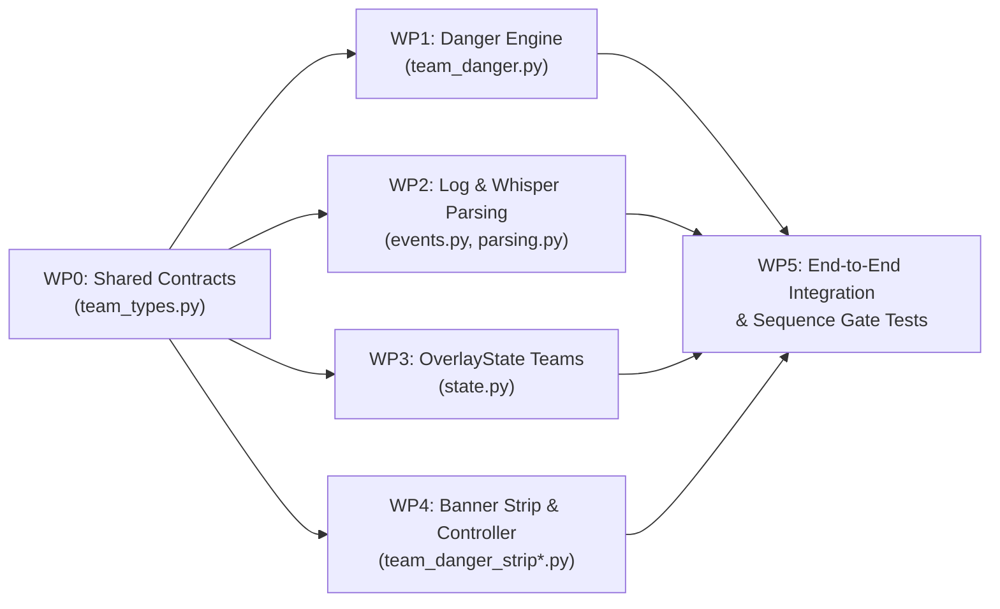

# Team Danger & Threat Priority Add-On — Engineering & Parallel Implementation Plan (v2)

> **Target Component:** `prism/` (Python Tkinter Client Overlay)  
> **Branch / Fork:** `feat/team-danger-rush`  
> **Target Gamemodes:** Hypixel Bedwars **3v3v3v3 (Threes)** & **4v4v4v4 (Fours)** (4 Teams: **Red, Blue, Green, Yellow**)  
> **Target Executor:** Flash 3.8 Agent(s) — Designed for **conflict-free parallel execution** after freezing shared contracts in **WP0**.

---

## 1. Executive Summary & Decision Scope

We are building a **Team Danger & Stat-Based Threat Priority Add-On** integrated into the Prism Overlay (`prism/`).

### 1.1. Explicit Decision Scope: Stat-Based Threat Priority (Not Map Routing)
* **What this tool decides:** **"Which enemy team (or player) should we prioritize based on stats?"**
  * Minecraft client logs (`latest.log`) do not expose player coordinates, island spawn order, or bed-defense blocks, and in Bedwars 3v3v3v3 / 4v4v4v4 all four bases are arranged symmetrically around the center island.
  * Therefore, this tool does **not** compute physical bridge directions or map geometry. Instead, it computes a calibrated **Team Danger Score $D(T)$** and identifies the **Primary Statistical Threat** so your party knows who to pressure early, who to contest at mid/diamonds, and which carry player to focus.
* **Opening vs. Mid-Game Recommendation Lifecycle**:
  * **Opening Phase (`in_queue` or `time_in_game <= 90.0s` with no final kills yet)**: Displays **`OPENING PRIORITY (BY STATS): [TEAM]`** — highlighting the most dangerous enemy team before beds are traded or emeralds spawn.
  * **Mid/Late-Game Phase (`time_in_game > 90.0s` or after any `BedwarsFinalKillEvent`)**: The opening rush recommendation expires and transitions to **`TOP ALIVE THREAT: [TEAM]`**, dynamically recalculating as players are final-killed or disconnect.

---

## 2. CRITICAL Repository Constraints (Read Before Coding)

Every agent implementing any work package in this document **MUST** obey these repository invariants:

1. **Working Directory for Commands**:
   * All Python commands (`uv run pytest`, `uv run mypy`, `uv run flake8`, `uv run black --check`, `uv run isort --check`) must be run from `prism/` (`C:\Users\Miraj Shah\Desktop\Personal Projects\bedwarsHw\prism\prism`).
2. **Logline Rules (`prism/tests/CLAUDE.md` & `prism/src/prism/overlay/CLAUDE.md`)**:
   * Any Minecraft logline in `prism/src/prism/overlay/` comments or `prism/tests/` **MUST** either be a byte-for-byte literal copy from `~/.minecraft/logs` with a proof, **OR** have a `# Synthetic: <why>. How: <how it was made>` comment immediately above the line or block.
   * Always include `# Synthetic: <why>. How: <how it was made>` above any new test loglines or docstring examples, and use only `Player1`, `Player2`, ..., `Me` as player names.
3. **Immutability (`frozen=True, slots=True`)**:
   * `OverlayState` (`state.py`) and all domain/render dataclasses use `@dataclass(frozen=True, slots=True)`. Never put mutable `dict` or `list` fields on `OverlayState` or render payloads — use `tuple` or `frozenset`.
4. **Controller / View Separation & 100% Test Coverage**:
   * All non-GUI modules are tested with `--cov-fail-under=100` in CI (`.github/workflows/testing.yml`).
   * Tkinter widget classes (`StatsTable`, `InfoStrip`, `MainContent`, `TeamDangerStrip`) carry `# pragma: nocover` on the class definition, while their state-machine controllers (`StatsTableController`, `InfoStripController`, `TeamDangerStripController`) are pure Python dataclasses with **100% unit test coverage**.
5. **Code Formatting & Linting (`.github/workflows/linting.yml`)**:
   * Line length limit is **88 characters** (`.flake8`).
   * Strict `mypy` typing is enforced (`disallow_untyped_defs`, exhaustive `assert_never`).

---

## 3. Calibrated Mathematical Model (Recalibrated for 3s & 4s)

### 3.1. Eliminating Double-Counting & Handling Small Sample Sizes
In Prism, `stats.index = stars * fkdr^2`. Using `fkdr`, `stars`, and `index` simultaneously double-counts both `fkdr` and `stars`. Furthermore, a 1-star alt with 5 finals and 0 final deaths (`fkdr = 5.0`) has too small a sample size to be trusted at face value.

To solve both problems:
1. **Do NOT use `stats.index` on top of `fkdr` and `stars`**. Instead, score `fkdr`, `bblr`, `wlr`, and $\sqrt{\text{stars}}$ orthogonally.
2. **Apply Sample-Size Confidence Damping $c(p) \in [0.25, 1.0]$** to ratio stats (`fkdr`, `bblr`, `wlr`):
   $$V(p) = \max(p.\text{stars}, 0.0) + 0.5 \times \max(p.\text{stats.wins}, 0) + 0.2 \times \max(p.\text{stats.finals}, 0)$$
   $$c(p) = \min\!\left(1.0,\ 0.25 + 0.75 \times \frac{V(p)}{50.0}\right)$$
   * A brand-new 1-star account with 0 wins and 5 finals has $V = 2.0 \implies c = 0.28$, damping noisy 1-game ratio spikes.
   * Any established player with $V(p) \ge 50.0$ (e.g., $\ge 25$ stars and $\sim 50$ wins/finals, or $\ge 50$ stars) has full confidence $c(p) = 1.0$.

### 3.2. Individual Player Danger Score $D(p)$

1. **For `KnownPlayer`**:
   * **Combat Lethality (`fkdr`, capped at `25.0`, damped by $c$)**:
     $$S_{\text{fkdr}} = c(p) \times \min(\max(p.\text{stats.fkdr}, 0.0),\ 25.0) \times 10.0$$
   * **Bed-Breaking Threat (`bblr`, capped at `10.0`, damped by $c$)**:
     $$S_{\text{bblr}} = c(p) \times \min(\max(p.\text{stats.bblr}, 0.0),\ 10.0) \times 6.0$$
   * **Win Conversion (`wlr`, capped at `10.0`, damped by $c$)**:
     $$S_{\text{wlr}} = c(p) \times \min(\max(p.\text{stats.wlr}, 0.0),\ 10.0) \times 5.0$$
   * **Experience (`stars`, square-root scaled, capped at `2500.0`)**:
     $$S_{\text{stars}} = \sqrt{\min(\max(p.\text{stars}, 0.0),\ 2500.0)} \times 0.8$$
   * **Winstreak Momentum (`winstreak`, capped at `50`)**:
     * If `p.stats.winstreak is not None`:
       $$S_{\text{ws}} = \min(\max(p.\text{stats.winstreak}, 0),\ 50) \times (1.5 \text{ if } p.\text{stats.winstreak\_accurate else } 1.0)$$
     * Else: $S_{\text{ws}} = 0.0$.
   * **Fresh-Login / Sniper Session Time (`sessiontime_seconds`)**:
     * Mirrors `DEFAULT_SESSIONTIME_CONFIG` (`config.py` line 181, where `< 5 min` and `< 10 min` logins are flagged):
       * If `p.sessiontime_seconds is not None and p.sessiontime_seconds < 300.0` (`< 5 min`): $S_{\text{session}} = 8.0$
       * Else if `p.sessiontime_seconds is not None and p.sessiontime_seconds < 600.0` (`5–10 min`): $S_{\text{session}} = 4.0$
       * Else: $S_{\text{session}} = 0.0$
   * **Urchin Tag Penalty (`tags`)**:
     * `sniping == "high"`: $+120.0$; `sniping == "medium"`: $+60.0$
     * `cheating == "high"`: $+100.0$; `cheating == "medium"`: $+50.0$
   * **Total `KnownPlayer` Score**:
     $$D(p) = \text{round}(S_{\text{fkdr}} + S_{\text{bblr}} + S_{\text{wlr}} + S_{\text{stars}} + S_{\text{ws}} + S_{\text{session}} + S_{\text{tags}},\ 1)$$

2. **For `NickedPlayer` (`status = "nicked"`)**:
   * **Calibrated Baseline Verification**:
     Under the formula above, a representative experienced player (`200 stars`, `3.5 FKDR`, `1.5 BBLR`, `1.5 WLR`, `2 accurate WS`, `session >= 10m`, `no tags`) scores:
     $$D(p) = 35.0 + 9.0 + 7.5 + (\sqrt{200} \times 0.8 = 11.31) + 3.0 = \mathbf{65.8}$$
   * Accordingly, we set `NICKED_PLAYER_DANGER = 65.0`. A `NickedPlayer` contributes `65.0` and is eligible for threat recommendations.

3. **For `PendingPlayer` (`status = "pending"`) & `UnknownPlayer` (`status = "unknown"`)**:
   * **Preventing False "Safe -> Jump" Tier Transitions**:
     * **`PendingPlayer`**: Numeric contribution is `0.0`, and `pending_count` on the team/lobby is incremented.
     * **`UnknownPlayer` (API error)**: Numeric contribution is `0.0` (NOT `35.0`, so 4 errored players never look like a 152-point threat!), and `unknown_count` on the team/lobby is incremented.
   * **Recommendation Eligibility Rules**:
     * A team with `pending_count > 0` has `tier = "pending"` (`GUI_COLORS[0] = "gray60"`) and is **ineligible** for `priority_target` recommendation while stats are still loading (unless all known enemy teams already exceed it, or the banner shows `LOADING STATS...` when any enemy team has `pending_count > 0`).
     * A team where **all** alive players are `UnknownPlayer` (`known_or_nicked_count == 0 and pending_count == 0`) has `tier = "unknown"` (`"gray60"`) and is **ineligible** to be recommended as `priority_target`.

### 3.3. Team Aggregate Danger $D(T)$ & Representative 3s/4s Roster Calibration
For an enemy team $T$ with alive players $P_T$:
* Let $P_{T,\text{scored}} = \{p \in P_T : \text{isinstance}(p, \text{KnownPlayer} \mid \text{NickedPlayer})\}$.
* If $P_{T,\text{scored}}$ is empty: $D(T) = 0.0$.
* Otherwise:
  $$\text{TotalSum}(T) = \sum_{p \in P_{T,\text{scored}}} D(p)$$
  $$\text{Peak}(T) = \max_{p \in P_{T,\text{scored}}} D(p)$$
  $$\text{SynergyBonus}(T) = 15.0 \times \max\!\big(0,\ |\{p \in P_{T,\text{scored}} : D(p) \ge 50.0\}| - 1\big)$$
  $$D(T) = \text{round}\big(\text{TotalSum}(T) + 0.35 \times \text{Peak}(T) + \text{SynergyBonus}(T),\ 1\big)$$

#### Calibration Table Against Representative 3v3v3v3 and 4v4v4v4 Rosters

| Archetype | Per-Player Profile | Player $D(p)$ | 3s Team $D(T)$ | 4s Team $D(T)$ | Target Tier |
| :--- | :--- | :---: | :---: | :---: | :---: |
| **Casual Queue** | 50★, 0.6 FKDR, 0.4 BBLR, 0.3 WLR, 0 WS | `15.6` | **`52.3`** | **`67.9`** | **`low`** (`< 100`) |
| **Average / Decent** | 150★, 1.8 FKDR, 1.0 BBLR, 0.8 WLR, 1 WS | `39.3` | **`131.7`** | **`171.0`** | **`medium`** (`100 .. < 180`) |
| **Solo Carry + Casuals** | 1× Carry (400★, 6.0 FKDR, 2.5 BBLR, 2.5 WLR, 5 WS) + Casuals | `111.0` / `15.6` | **`181.1`** | **`196.7`** | **`high`** (`180 .. < 300`) |
| **Good Party / All Nicks** | 200★, 3.5 FKDR, 1.5 BBLR, 1.5 WLR, 2 WS (or Nicks) | `65.8` (`65.0`) | **`250.4`** | **`331.2`** | **`high` (3s) / `extreme` (4s)** |
| **Sweat Winstreak Stack** | 600★, 8.0 FKDR, 3.0 BBLR, 3.5 WLR, 15 WS | `157.6` | **`558.0`** | **`730.6`** | **`extreme`** (`>= 300`) |
| **4× Unknown (API Error)** | 4× `UnknownPlayer` | `0.0` | **`0.0`** | **`0.0`** | **`unknown`** (Ineligible) |
| **Loading Team** | Any `PendingPlayer` present | `0.0` | *Partial* | *Partial* | **`pending`** (Ineligible) |

#### Calibrated Tier Thresholds (`DangerTier`)
* `"pending"` (when `pending_count > 0`) $\rightarrow$ `GUI_COLORS[0]` (`"gray60"`)
* `"unknown"` (when `known_or_nicked_count == 0 and pending_count == 0`) $\rightarrow$ `GUI_COLORS[0]` (`"gray60"`)
* `"low"` (`< 100.0`) $\rightarrow$ `GUI_COLORS[1]` (`"snow"`)
* `"medium"` (`100.0 .. < 180.0`) $\rightarrow$ `GUI_COLORS[2]` (`"yellow"`)
* `"high"` (`180.0 .. < 300.0`) $\rightarrow$ `GUI_COLORS[3]` (`"#FF8800"`)
* `"extreme"` (`>= 300.0`) $\rightarrow$ `GUI_COLORS[4]` (`"red"`)

### 3.4. Deterministic Tie-Breaking Rules
1. **Player Sorting Key**:
   * Eligible known/nicked players sort before `unknown`, which sort before `pending`.
   * Tie-breaker tuple (ascending sort key):
     ```python
     (
         player_danger.status == "pending",
         player_danger.status == "unknown",
         -player_danger.danger_score,
         -player_fkdr_or_zero,
         -player_stars_or_zero,
         player_danger.username.lower(),
         player_danger.username,
     )
     ```
2. **Team Sorting Key**:
   * Eligible teams (`tier not in ("pending", "unknown")`) sort before `"pending"`, which sort before `"unknown"`.
   * Canonical team color order: `TEAM_ORDER_INDEX = {"red": 0, "blue": 1, "green": 2, "yellow": 3}`.
   * Tie-breaker tuple (ascending sort key):
     ```python
     (
         summary.tier == "unknown",
         summary.tier == "pending",
         -summary.danger_score,
         -summary.peak_player_danger,
         -summary.alive_count,
         TEAM_ORDER_INDEX[summary.team],
     )
     ```

---

## 4. Shared Contracts & Semantics (Frozen in WP0)

To guarantee zero type duplication and allow **WP1, WP2, WP3, and WP4** to execute in parallel without cross-dependencies, **WP0** creates `prism/src/prism/overlay/team_types.py` first.

### 4.1. Identity, Alias/Denick Resolution, and Liveness Rules
1. **Alias-Aware Party Membership (`is_friendly_player`)**:
   * A player in `state.lobby_players` may be a nick (`"AmazingNick"`) that resolved to `KnownPlayer(username="RealUser", nick="AmazingNick")`.
   * A player is friendly if `any(alias in state.party_members for alias in player.aliases)` OR (if `state.own_username is not None` and `state.own_username in player.aliases`).
2. **Alias-Aware Team Lookup (`resolve_player_team`)**:
   * Given `team_map: Mapping[str, TeamColor]`, a player's team is resolved by checking `player.aliases` in reverse order (`nick` first if present, then `username`), case-insensitively matching keys in `team_map`.
   * If any friendly player resolves to a team color $T_{\text{own}}$, then $T_{\text{own}}$ is marked `is_own_team = True`, and all players assigned to $T_{\text{own}}$ are treated as friendly (excluded from enemy rush targets).
3. **Liveness vs. `settings.hide_dead_players`**:
   * `StatsTable` rows continue to display `state.alive_players if settings.hide_dead_players else state.lobby_players`.
   * **Team Danger calculation MUST filter `players` to only those whose `aliases` intersect `state.alive_players`**! Even when `settings.hide_dead_players` is `False`, dead/disconnected players must **never** contribute to active team danger or alive counts.
4. **Mode Eligibility & Suppression**:
   * If `state.bedwars_duel is not None` (Bedwars Duel) or `len(state.lobby_players) > 16` (mega/non-standard lobby) or there are 0 alive enemy players, `calculate_lobby_danger()` returns a summary that renders as `None` (banner hidden/cleared).
5. **Banner Update & Clear Semantics in `run_overlay.py` & `StatsOverlay`**:
   * Pairing the banner update with `new_rows is not None` provides a deterministic update/clear contract:
     * When `new_players is None` (no redraw this tick): `new_rows = None` and `new_banner = None` (no update).
     * When `new_players is not None`: `MainContent.update_content(info_cells, new_rows, new_banner)` **always** calls `self.team_danger_strip.tick(new_banner)`. If `new_banner is None` (e.g., lobby cleared, game ended, duel mode, or no enemies), `team_danger_strip.tick(None)` destroys its labels and shrinks to 1px height.
     * When `StatsOverlay` is hidden (`not self.window.shown or self.current_page != "main"`), if `new_rows is not None`, `StatsOverlay` stores **both** `self.last_new_rows = new_rows` and `self.last_new_banner = new_banner`, and flushes both when the window is shown again (e.g. when pressing `Tab`).

---

## 5. Parallelizable Work Packages (WP0 $\rightarrow$ WP1–WP4 $\rightarrow$ WP5)



### File Ownership Matrix

| Work Package | Phase | Files Created / Modified |
| :--- | :---: | :--- |
| **WP0: Frozen Shared Contracts** | **Phase 0 (First)** | `prism/src/prism/overlay/team_types.py` *(new)*<br>`prism/tests/prism/overlay/test_team_types.py` *(new)* |
| **WP1: Team Danger Engine** | **Phase 1 (Parallel)** | `prism/src/prism/overlay/team_danger.py` *(new)*<br>`prism/tests/prism/overlay/test_team_danger.py` *(new)* |
| **WP2: Chat & Whisper Team Parsing** | **Phase 1 (Parallel)** | `prism/src/prism/overlay/events.py`<br>`prism/src/prism/overlay/parsing.py`<br>`prism/tests/prism/overlay/test_parsing.py` |
| **WP3: OverlayState Team Tracking** | **Phase 1 (Parallel)** | `prism/src/prism/overlay/state.py`<br>`prism/tests/prism/overlay/test_state.py`<br>`prism/tests/prism/overlay/utils.py` |
| **WP4: Team Danger UI Strip & Controller** | **Phase 1 (Parallel)** | `prism/src/prism/overlay/output/overlay/team_danger_strip_controller.py` *(new)*<br>`prism/src/prism/overlay/output/overlay/team_danger_strip.py` *(new)*<br>`prism/tests/prism/overlay/output/overlay/test_team_danger_strip_controller.py` *(new)* |
| **WP5: Integration & Sequence Gate** | **Phase 2 (Final)** | `prism/src/prism/overlay/process_event.py`<br>`prism/src/prism/overlay/output/overlay/main_content.py`<br>`prism/src/prism/overlay/output/overlay/run_overlay.py`<br>`prism/src/prism/overlay/output/overlay/stats_overlay.py`<br>`prism/src/prism/overlay/output/overlay/utils.py`<br>`prism/tests/prism/overlay/test_process_event.py`<br>`prism/tests/prism/overlay/output/overlay/test_overlay.py`<br>`prism/tests/prism/overlay/output/overlay/test_run_overlay.py` |

---

### Work Package 0 (WP0): Frozen Shared Contracts (`team_types.py`)

**Goal**: Define the single source of truth for `TeamColor`, `DangerTier`, `RecommendationPhase`, and all shared dataclasses so WP1, WP2, WP3, and WP4 have zero cross-dependencies.

#### Files to Create
1. `prism/src/prism/overlay/team_types.py`
2. `prism/tests/prism/overlay/test_team_types.py`

#### Exact Code Specification (`prism/src/prism/overlay/team_types.py`)
```python
from dataclasses import dataclass
from typing import Literal, TypeGuard

from prism.overlay.output.cells import GUI_COLORS, CellValue
from prism.overlay.output.color import MinecraftColor

TeamColor = Literal["red", "blue", "green", "yellow"]
PlayerStatStatus = Literal["known", "nicked", "pending", "unknown"]
DangerTier = Literal["low", "medium", "high", "extreme", "pending", "unknown"]
RecommendationPhase = Literal["opening", "midgame"]

ALL_TEAM_COLORS: tuple[TeamColor, ...] = ("red", "blue", "green", "yellow")

TEAM_ORDER_INDEX: dict[TeamColor, int] = {
    "red": 0,
    "blue": 1,
    "green": 2,
    "yellow": 3,
}

TEAM_DISPLAY_NAMES: dict[TeamColor, str] = {
    "red": "RED",
    "blue": "BLUE",
    "green": "GREEN",
    "yellow": "YELLOW",
}

TEAM_SHORT_LABELS: dict[TeamColor, str] = {
    "red": "R",
    "blue": "B",
    "green": "G",
    "yellow": "Y",
}

TEAM_MINECRAFT_COLORS: dict[TeamColor, str] = {
    "red": MinecraftColor.RED,
    "blue": MinecraftColor.BLUE,
    "green": MinecraftColor.GREEN,
    "yellow": MinecraftColor.YELLOW,
}

TEAM_ALIAS_MAP: dict[str, TeamColor] = {
    "red": "red",
    "r": "red",
    "blue": "blue",
    "b": "blue",
    "green": "green",
    "g": "green",
    "yellow": "yellow",
    "y": "yellow",
}


def str_is_team_color(value: str, /) -> TypeGuard[TeamColor]:
    """Return True if value is a valid 3s/4s TeamColor."""
    return value in TEAM_ORDER_INDEX


def danger_tier_to_gui_color(tier: DangerTier) -> str:
    """Map a DangerTier to its GUI color string."""
    if tier in ("pending", "unknown"):
        return GUI_COLORS[0]
    if tier == "low":
        return GUI_COLORS[1]
    if tier == "medium":
        return GUI_COLORS[2]
    if tier == "high":
        return GUI_COLORS[3]
    return GUI_COLORS[4]


@dataclass(frozen=True, slots=True)
class PlayerDanger:
    username: str
    danger_score: float
    status: PlayerStatStatus
    tier: DangerTier
    team: TeamColor | None


@dataclass(frozen=True, slots=True)
class TeamDangerSummary:
    team: TeamColor
    danger_score: float
    total_player_danger: float
    peak_player_danger: float
    tier: DangerTier
    alive_count: int
    known_or_nicked_count: int
    pending_count: int
    unknown_count: int
    top_player: str | None
    is_own_team: bool

    @property
    def is_eligible_target(self) -> bool:
        """True if this team can be recommended as a priority target."""
        return (
            not self.is_own_team
            and self.alive_count > 0
            and self.pending_count == 0
            and self.known_or_nicked_count > 0
        )


@dataclass(frozen=True, slots=True)
class LobbyDangerSummary:
    phase: RecommendationPhase
    enemy_teams: tuple[TeamDangerSummary, ...]
    own_team: TeamDangerSummary | None
    priority_target: TeamDangerSummary | None
    unassigned_enemies: tuple[PlayerDanger, ...]
    pending_enemy_count: int
    unknown_enemy_count: int


@dataclass(frozen=True, slots=True)
class TeamDangerBannerData:
    """Immutable render payload for the TeamDangerStrip widget."""

    headline: CellValue
    team_summary_line: CellValue | None
```

#### Verification Command for WP0
```powershell
cd prism
uv run pytest tests/prism/overlay/test_team_types.py --cov=prism.overlay.team_types --cov-fail-under=100
uv run mypy src/prism/overlay/team_types.py tests/prism/overlay/test_team_types.py
uv run flake8 src/prism/overlay/team_types.py tests/prism/overlay/test_team_types.py
```

---

### Work Package 1 (WP1): Core Team Danger Calculation Engine (`team_danger.py`)

**Goal**: Implement the pure calculation engine in `prism/src/prism/overlay/team_danger.py` using the exact formulas, eligibility rules, and tie-breakers from Section 3 & Section 4.

#### Files to Create
1. `prism/src/prism/overlay/team_danger.py`
2. `prism/tests/prism/overlay/test_team_danger.py`

#### Key Functions & Rules to Implement
* `sample_confidence(player: KnownPlayer) -> float`:
  * Computes $V(p) = \max(p.\text{stars}, 0.0) + 0.5 \times \max(p.\text{stats.wins}, 0) + 0.2 \times \max(p.\text{stats.finals}, 0)$ and returns $\min(1.0, 0.25 + 0.75 \times (V(p) / 50.0))$.
* `classify_score_tier(score: float) -> Literal["low", "medium", "high", "extreme"]`:
  * `< 100.0` $\rightarrow$ `"low"`, `< 180.0` $\rightarrow$ `"medium"`, `< 300.0` $\rightarrow$ `"high"`, `>= 300.0` $\rightarrow$ `"extreme"`.
* `calculate_player_danger(player: Player, team: TeamColor | None = None) -> PlayerDanger`:
  * Implements Section 3.2 (`KnownPlayer`, `NickedPlayer = 65.0`, `PendingPlayer = 0.0`, `UnknownPlayer = 0.0`).
* `resolve_player_team(player: Player, player_teams: Mapping[str, TeamColor]) -> TeamColor | None`:
  * Checks `reversed(player.aliases)` against `player_teams` (case-insensitive key match).
* `is_player_alive(player: Player, alive_players: Set[str]) -> bool`:
  * Returns `any(alias in alive_players for alias in player.aliases)`.
* `is_friendly_player(player: Player, party_members: Set[str], own_username: str | None) -> bool`:
  * Returns `any(alias in party_members or alias == own_username for alias in player.aliases)`.
* `calculate_lobby_danger(...) -> LobbyDangerSummary | None`:
  * Signature:
    ```python
    def calculate_lobby_danger(
        players: Sequence[Player],
        *,
        alive_players: Set[str],
        party_members: Set[str],
        own_username: str | None,
        player_teams: Mapping[str, TeamColor],
        time_in_game: float | None = None,
        any_final_kills: bool = False,
        is_duel: bool = False,
        lobby_size: int = 0,
    ) -> LobbyDangerSummary | None:
    ```
  * Returns `None` if `is_duel` is `True`, `lobby_size > 16`, or there are 0 alive enemy players.
  * Filters `players` to only those where `is_player_alive(player, alive_players)` is `True`.
  * Determines `phase: RecommendationPhase`:
    * `"midgame"` if `any_final_kills` is `True` or (`time_in_game is not None and time_in_game > 90.0`), else `"opening"`.
  * Identifies `own_team_color`: if any friendly player has a resolved team in `player_teams`, that color is `own_team_color` (if multiple friendly players have different colors due to a stale command, pick the one matching `own_username` first, else lowest `TEAM_ORDER_INDEX`).
  * Builds `TeamDangerSummary` for each `TeamColor` that has $\ge 1$ alive player:
    * `priority_target` is the first team in sorted `enemy_teams` where `team.is_eligible_target` is `True` AND `pending_enemy_count == 0` across assigned enemy teams (if any assigned enemy team still has `pending_count > 0`, `priority_target` is `None` so the UI does not recommend a premature target before stats finish loading!).
  * Populates `unassigned_enemies` (alive non-friendly players whose resolved team is `None`) sorted deterministically per Section 3.4.

#### Mandatory Unit Tests in `test_team_danger.py`
* Test all 5 representative rosters from the Calibration Table (Casual, Average, Solo Carry, Good/Nick Party, Sweat Stack) in both 3s and 4s and assert their exact scores and tiers.
* Test small-sample damping (`1 star, 5 FKDR` vs `200 star, 5 FKDR`).
* Test `sessiontime_seconds` (`< 300s`, `300..600s`, `>= 600s`, `None`).
* Test `PendingPlayer` and `UnknownPlayer` eligibility suppression (4 unknowns $\rightarrow$ `0.0`, `"unknown"` tier, `priority_target is None`; 1 pending on an enemy team $\rightarrow$ `priority_target is None`).
* Test alias resolution for denicked players (`KnownPlayer(username="Real", nick="Nick")`) for both `party_members`, `alive_players`, and `player_teams`.
* Test deterministic tie-breaking on identical player and team scores.
* Test `opening` vs `midgame` phase transition (`time_in_game <= 90` vs `> 90` and `any_final_kills=True`).

#### Verification Command for WP1
```powershell
cd prism
uv run pytest tests/prism/overlay/test_team_danger.py --cov=prism.overlay.team_danger --cov-fail-under=100
uv run mypy src/prism/overlay/team_danger.py tests/prism/overlay/test_team_danger.py
uv run flake8 src/prism/overlay/team_danger.py tests/prism/overlay/test_team_danger.py
```

---

### Work Package 2 (WP2): Log Parsing & Team Detection Events (`events.py`, `parsing.py`)

**Goal**: Parse team assignments (`TeamColor`) from `[SHOUT] [RED]`, `[RED]` team chat, and `/w !<team>=Player1,Player2` whisper commands using `TeamColor` from `prism.overlay.team_types`.

#### Files to Modify
1. `prism/src/prism/overlay/events.py`
2. `prism/src/prism/overlay/parsing.py`
3. `prism/tests/prism/overlay/test_parsing.py`

#### Detailed Changes
1. **`prism/src/prism/overlay/events.py`**:
   * Import `TeamColor` from `prism.overlay.team_types`.
   * Add `WHISPER_COMMAND_SET_TEAM = auto()` to `EventType`.
   * Add `team: TeamColor | None = None` to `ChatMessageEvent`:
     ```python
     @dataclass
     class ChatMessageEvent:
         username: str
         message: str
         team: TeamColor | None = None
         event_type: Literal[EventType.CHAT_MESSAGE] = EventType.CHAT_MESSAGE
     ```
   * Add `WhisperCommandSetTeamEvent`:
     ```python
     @dataclass
     class WhisperCommandSetTeamEvent:
         team: TeamColor | None
         usernames: list[str]
         event_type: Literal[EventType.WHISPER_COMMAND_SET_TEAM] = (
             EventType.WHISPER_COMMAND_SET_TEAM
         )
     ```
     and include it in `ChatEvent`.

2. **`prism/src/prism/overlay/parsing.py`**:
   * Import `TEAM_ALIAS_MAP`, `TeamColor` from `prism.overlay.team_types`.
   * **Chat / Shout Team Extraction**:
     * Helper `extract_chat_team(prefix_before_colon: str) -> TeamColor | None`:
       Checks for `"[RED] "`, `"[BLUE] "`, `"[GREEN] "`, `"[YELLOW] "` in `prefix_before_colon` before `remove_ranks()` strips bracket tags.
     * Pass `team=extract_chat_team(message[:colon_index])` when constructing `ChatMessageEvent`.
   * **Whisper Command Team Assignment**:
     * In `WHISPER_COMMAND_PREFIX` (`Can't find a player by the name of '!...'`), when `=` is in `command`:
       * Split `lhs, rhs = arguments`.
       * Let `lhs_lower = lhs.lower()`.
       * If `lhs_lower in TEAM_ALIAS_MAP`:
         * Parse `usernames = [u.strip() for u in rhs.split(",") if u.strip()]`.
         * If `not usernames` or not all `valid_username(u)` for `u` in `usernames`: return `None`.
         * Return `WhisperCommandSetTeamEvent(team=TEAM_ALIAS_MAP[lhs_lower], usernames=usernames)`.
       * If `lhs_lower in ("unteam", "clearteam")`:
         * If `not rhs`: return `WhisperCommandSetTeamEvent(team=None, usernames=[])` (clears all teams).
         * Else validate comma-separated `usernames` with `valid_username` and return `WhisperCommandSetTeamEvent(team=None, usernames=usernames)`.
       * Otherwise, fall through to existing `WhisperCommandSetNickEvent(nick=lhs, username=rhs if rhs else None)` so `/w !nick=username` works identically to before!

3. **`prism/tests/prism/overlay/test_parsing.py`**:
   * Update the 3 existing `[SHOUT]` test cases at lines 759, 764, 770 (`[SHOUT] [RED]` and `[SHOUT] [GREEN]`) to expect `team="red"` and `team="green"`.
   * Add synthetic test cases (each with `# Synthetic: <why>. How: <how>`) for:
     * `[SHOUT] [BLUE]` and `[SHOUT] [YELLOW]`
     * `/w !red=Player1`, `/w !b=Player1,Player2`, `/w !unteam=Player1`, `/w !unteam=`
     * Invalid whisper team commands (`/w !red=`, `/w !red=Invalid-Name!`) returning `None`.

#### Verification Command for WP2
```powershell
cd prism
uv run pytest tests/prism/overlay/test_parsing.py --cov=prism.overlay.parsing --cov=prism.overlay.events --cov-fail-under=100
uv run pytest tests/test_loglines.py
uv run mypy src/prism/overlay/events.py src/prism/overlay/parsing.py
uv run flake8 src/prism/overlay/events.py src/prism/overlay/parsing.py
```

---

### Work Package 3 (WP3): `OverlayState` Team Tracking (`state.py`)

**Goal**: Store player team assignments immutably on `OverlayState` using `TeamColor` from `prism.overlay.team_types`, with well-defined lifecycle rules across queue, `/who`, mid-game `/who`, and game end.

#### Files to Modify
1. `prism/src/prism/overlay/state.py`
2. `prism/tests/prism/overlay/test_state.py`
3. `prism/tests/prism/overlay/utils.py`

#### Detailed Changes
1. **`prism/src/prism/overlay/state.py`**:
   * Import `TeamColor` from `prism.overlay.team_types`.
   * Add field to `OverlayState`:
     ```python
     player_teams: frozenset[tuple[str, TeamColor]] = frozenset()
     ```
   * Add properties & methods:
     * `@property def team_map(self) -> dict[str, TeamColor]`:
       Returns `dict(self.player_teams)`.
     * `@property def has_final_kills_or_deaths(self) -> bool`:
       Returns `self.lobby_players != self.alive_players`.
     * `def set_player_team(self, username: str, team: TeamColor | None) -> Self`:
       Removes any `(u, t)` where `u.lower() == username.lower()`, and if `team is not None`, adds `(username, team)`.
     * `def set_players_team(self, usernames: Iterable[str], team: TeamColor | None) -> Self`:
       Applies `set_player_team` for each username in `usernames`.
     * `def clear_teams(self) -> Self`:
       Returns `replace(self, player_teams=frozenset())`.
   * **Lifecycle Rules**:
     * `clear_lobby(self) -> Self`: Clears `lobby_players`, `alive_players`, AND resets `player_teams=frozenset()`.
     * `leave_game(self) -> Self`: Resets `last_game_start=None`, `bedwars_duel=None`, AND `player_teams=frozenset()`.
     * `set_lobby(self, new_lobby: Iterable[str]) -> Self` (called on `/who`):
       Updates `lobby_players` and `alive_players` to `frozenset(new_lobby)`, and **filters `player_teams`** to keep `(u, t)` for players still in `new_lobby` or `self.party_members` (case-insensitive), so mid-game `/who` preserves known teams for alive players while pruning stale entries from a previous lobby!

#### Verification Command for WP3
```powershell
cd prism
uv run pytest tests/prism/overlay/test_state.py --cov=prism.overlay.state --cov-fail-under=100
uv run mypy src/prism/overlay/state.py tests/prism/overlay/test_state.py tests/prism/overlay/utils.py
uv run flake8 src/prism/overlay/state.py tests/prism/overlay/test_state.py tests/prism/overlay/utils.py
```

---

### Work Package 4 (WP4): Headless `TeamDangerStripController` & `TeamDangerStrip` Widget

**Goal**: Implement the pure banner formatting logic and controller (`team_danger_strip_controller.py`, 100% test coverage) and the Tkinter view (`team_danger_strip.py`, `# pragma: nocover`), importing only from `prism.overlay.team_types` and `prism.overlay.output.cells`.

#### Files to Create
1. `prism/src/prism/overlay/output/overlay/team_danger_strip_controller.py`
2. `prism/src/prism/overlay/output/overlay/team_danger_strip.py`
3. `prism/tests/prism/overlay/output/overlay/test_team_danger_strip_controller.py`

#### Banner Formatting Rules (`format_lobby_danger_banner(summary: LobbyDangerSummary | None) -> TeamDangerBannerData | None`)
1. If `summary is None` or (`not summary.enemy_teams and not summary.unassigned_enemies`):
   * Return `None`.
2. **Headline (`headline: CellValue`)**:
   * **Case A — Stats still loading (`summary.pending_enemy_count > 0`)**:
     * Text: `f"TEAM DANGER: Loading enemy stats ({summary.pending_enemy_count} pending)..."`
     * Color: `GUI_COLORS[0]` (`"gray60"`).
   * **Case B — Priority Enemy Team Available (`summary.priority_target is not None`)**:
     * Let `target = summary.priority_target`.
     * Prefix label based on `summary.phase`:
       * `"opening"` $\rightarrow$ `"OPENING TARGET (STATS): "`
       * `"midgame"` $\rightarrow$ `"TOP ALIVE THREAT: "`
     * Team badge: `f"[{TEAM_DISPLAY_NAMES[target.team]}]"` colored in `TEAM_MINECRAFT_COLORS[target.team]`.
     * Details: `f" Danger {target.danger_score:.0f} ({target.alive_count} alive{f', Carry: {target.top_player}' if target.top_player else ''})"` colored in `danger_tier_to_gui_color(target.tier)`.
   * **Case C — No Enemy Teams Assigned Yet (`summary.enemy_teams == ()`, right after `/who`)**:
     * Find top eligible unassigned enemy (`status in ("known", "nicked")`).
     * If found (`top = eligible[0]`):
       * Prefix: `"TOP UNASSIGNED THREAT: "` (`"snow"`) + `f"{top.username} (Danger {top.danger_score:.0f})"` (colored in `danger_tier_to_gui_color(top.tier)`) + `" | /w !r=Name sets team"` (`"gray60"`).
     * Else (all unassigned enemies are `"unknown"`):
       * Monochrome `"TEAM DANGER: Enemy stats unavailable (error)"` in `GUI_COLORS[0]`.
3. **Second Line (`team_summary_line: CellValue | None`)**:
   * If `summary.enemy_teams` is non-empty:
     * Renders each enemy team in `summary.enemy_teams` order separated by `"   "`:
       * `f"[{TEAM_DISPLAY_NAMES[t.team]}]"` (in `TEAM_MINECRAFT_COLORS[t.team]`) + `f" {t.danger_score:.0f}{'*' if t.pending_count else '?' if t.unknown_count else ''} ({t.alive_count})"` (in `danger_tier_to_gui_color(t.tier)`).
     * If `summary.unassigned_enemies` is also non-empty, appends `"   [UNASSIGNED] "` + `f"{len(summary.unassigned_enemies)}"` in `"gray60"`.
   * Else: `None`.

#### Verification Command for WP4
```powershell
cd prism
uv run pytest tests/prism/overlay/output/overlay/test_team_danger_strip_controller.py --cov=prism.overlay.output.overlay.team_danger_strip_controller --cov-fail-under=100
uv run mypy src/prism/overlay/output/overlay/team_danger_strip_controller.py src/prism/overlay/output/overlay/team_danger_strip.py
uv run flake8 src/prism/overlay/output/overlay/team_danger_strip_controller.py src/prism/overlay/output/overlay/team_danger_strip.py
```

---

### Work Package 5 (WP5): End-to-End Integration & Multi-Step Sequence Gate

**Goal**: Connect WP0–WP4 across `process_event.py`, `utils.py`, `main_content.py`, `stats_overlay.py`, and `run_overlay.py`, and verify the complete lifecycle sequence with deterministic integration tests.

#### Files to Modify
1. `prism/src/prism/overlay/process_event.py`
2. `prism/src/prism/overlay/output/overlay/utils.py`
3. `prism/src/prism/overlay/output/overlay/main_content.py`
4. `prism/src/prism/overlay/output/overlay/stats_overlay.py`
5. `prism/src/prism/overlay/output/overlay/run_overlay.py`
6. `prism/tests/prism/overlay/test_process_event.py`
7. `prism/tests/prism/overlay/output/overlay/test_overlay.py`
8. `prism/tests/prism/overlay/output/overlay/test_run_overlay.py`

#### Detailed Integration Changes
1. **`prism/src/prism/overlay/process_event.py`**:
   * In `EventType.CHAT_MESSAGE`:
     * When `state.in_queue or state.in_game`:
       ```python
       new_state = state.add_to_lobby(event.username)
       if event.team is not None:
           new_state = new_state.set_player_team(event.username, event.team)
       return new_state, True
       ```
   * In `EventType.WHISPER_COMMAND_SET_TEAM`:
     * If `not event.usernames` and `event.team is None`:
       `return state.clear_teams(), True`
     * Else:
       `return state.set_players_team(event.usernames, event.team), True`
2. **`prism/src/prism/overlay/output/overlay/utils.py`**:
   * Add `with_team_color(row: OverlayRowData, team: TeamColor | None) -> OverlayRowData`:
     * If `team is None`, return `row` unchanged.
     * If `team is not None`, prepend `f"[{TEAM_SHORT_LABELS[team]}] "` and color the `[X]` prefix (or the entire username cell) in `TEAM_MINECRAFT_COLORS[team]`.
3. **`prism/src/prism/overlay/output/overlay/main_content.py` & `stats_overlay.py` & `run_overlay.py`**:
   * `MainContent` mounts `self.team_danger_strip = TeamDangerStrip(parent=self.frame)` between `self.info_strip` and `self.stats_table`.
   * `MainContent.update_content(self, info_cells: list[InfoCellValue], new_rows: list[OverlayRowData] | None, team_danger_banner: TeamDangerBannerData | None = None) -> None`:
     * When `new_rows is not None`, updates `self.team_danger_strip.tick(team_danger_banner)` in lockstep with `self.stats_table.tick(gui_rows, column_order)`.
   * `StatsOverlay` stores `self.last_new_banner: TeamDangerBannerData | None` alongside `self.last_new_rows` so updates that occur while `StatsOverlay` is hidden are preserved and rendered immediately when the user presses `Tab`.
   * `run_overlay.py` computes `lobby_danger` via `calculate_lobby_danger(...)` and `format_lobby_danger_banner(lobby_danger)` whenever `new_players is not None`.

#### Mandatory End-to-End Integration Sequence Gate (`test_run_overlay.py` & `test_process_event.py`)
WP5 **must** include an end-to-end sequence test verifying this exact progression:
1. **`/who` with pending stats**: `LobbyListEvent(["Me", "NickAlly", "Enemy1", "Enemy2", "Enemy3", "Enemy4"])` while `Enemy1..4` are `PendingPlayer` $\rightarrow$ Banner shows `Loading enemy stats`, `priority_target is None` (no false `"low"` tier).
2. **Stats resolve + Denicked Teammate**: `NickAlly` resolves to `KnownPlayer(username="PartyMate", nick="NickAlly")` where `"PartyMate" in state.party_members`; `Enemy1..4` resolve to `KnownPlayer`s $\rightarrow$ `NickAlly` is recognized as friendly via alias; banner shows `TOP UNASSIGNED THREAT`.
3. **Partial & Full Team Assignments**:
   * `[SHOUT] [RED] Enemy1: hi` and `/w !blue=Enemy2,Enemy3` and `[SHOUT] [GREEN] NickAlly: inc` $\rightarrow$ `Green` is identified as `own_team` (`is_own_team=True`, excluded from enemy targets); `Red` and `Blue` are ranked; banner shows `OPENING TARGET (STATS): [RED]` (or `[BLUE]` depending on score).
4. **Final Kill + Both `hide_dead_players` Settings + Phase Transition**:
   * `BedwarsFinalKillEvent(dead_player="Enemy1")` $\rightarrow$ `any_final_kills` becomes `True` (phase transitions from `"opening"` to `"midgame": TOP ALIVE THREAT`).
   * Verify that with **both** `settings.hide_dead_players = True` AND `settings.hide_dead_players = False`, `Enemy1` is excluded from `Red`'s danger score and alive count (`Red` drops to 0 alive and `Blue` becomes `TOP ALIVE THREAT`).
5. **Mid-Game `/who`**:
   * `LobbyListEvent(["Me", "NickAlly", "Enemy2", "Enemy3"])` $\rightarrow$ preserves `Blue` team assignments for `Enemy2` and `Enemy3`.
6. **Hide / Show Window Caching**:
   * While overlay visibility is `Hidden`, a new team assignment arrives (`new_rows is not None`) $\rightarrow$ cached in `last_new_rows` and `last_new_banner` $\rightarrow$ user presses `Tab` (`Shown`) $\rightarrow$ `MainContent.update_content` receives both cached rows and cached banner.
7. **Unsupported Mode & New Match Reset**:
   * `EndBedwarsGameEvent()` or `LobbySwapEvent()` $\rightarrow$ clears `player_teams` and passes `team_danger_banner = None` (clearing the banner).
   * `StartBedwarsGameEvent(is_bedwars_duel=True)` $\rightarrow$ `is_duel=True` suppresses the banner (`None`).

#### Final Verification Commands
```powershell
cd prism
uv run pytest --cov=prism --cov-fail-under=100
uv run mypy src tests
uv run flake8 src tests
uv run black --check src tests
uv run isort --check src tests
```
